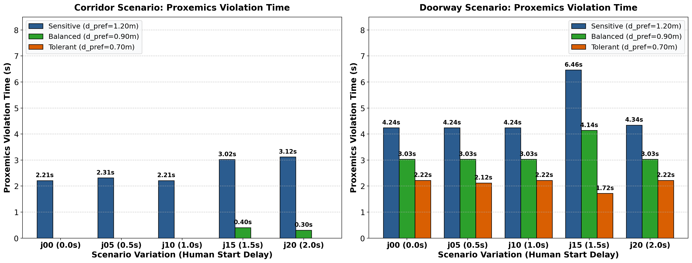
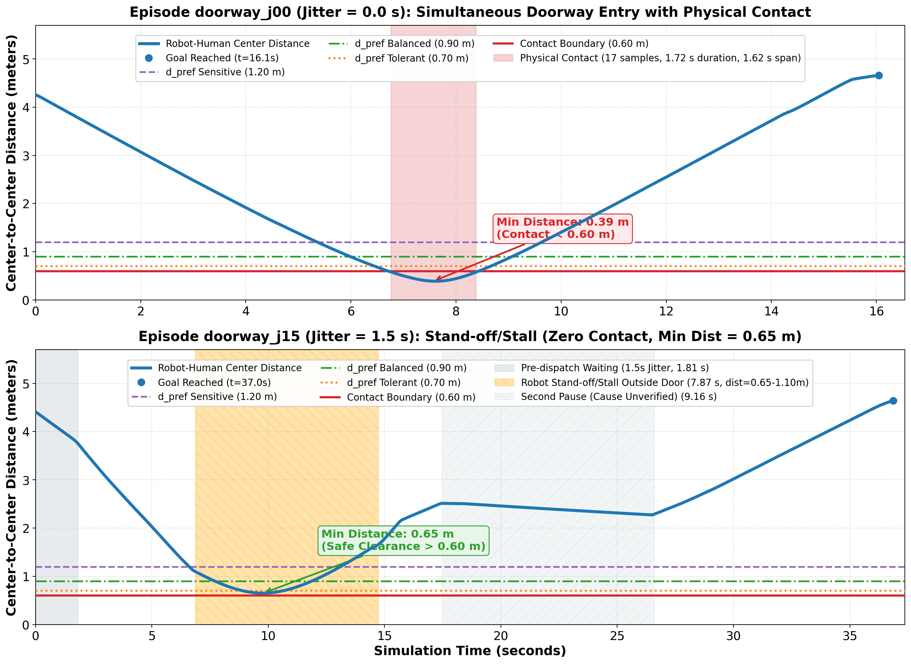
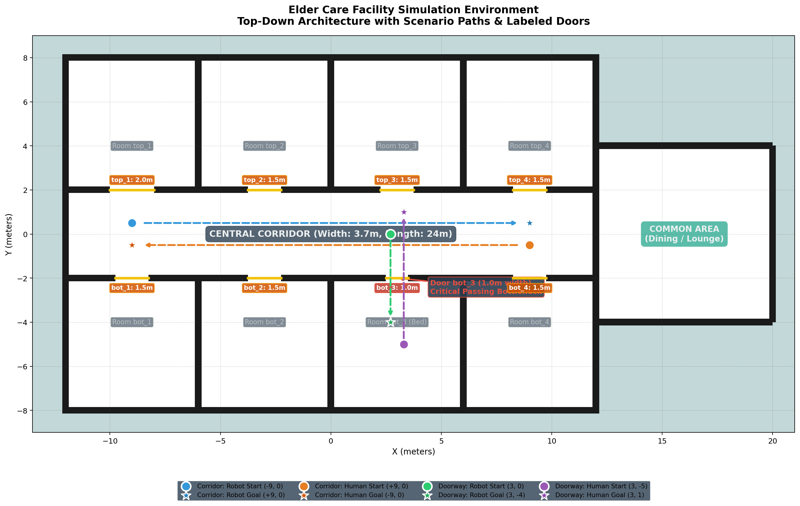
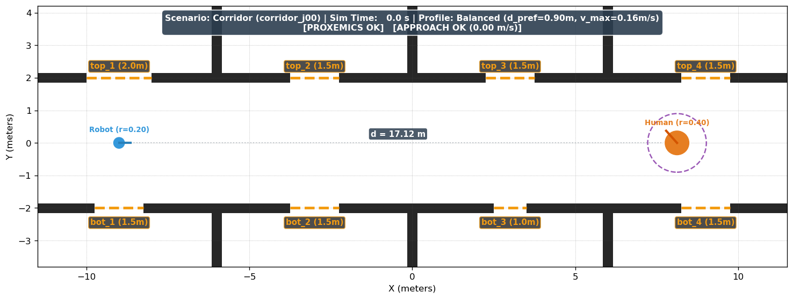
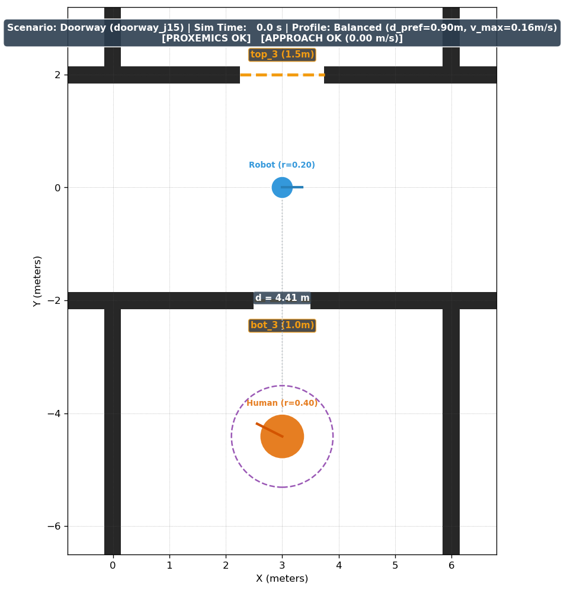
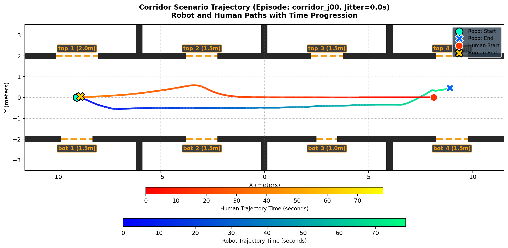
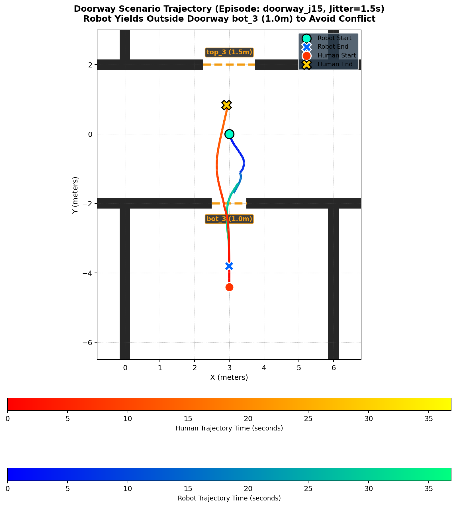

# Batch Evaluation Report: Corridor & Doorway Scenarios (Verified & Corrected)

**Date**: October 20, 2026  
**Git Branch**: `gazebo-migration` (Latest commit [`553d1ee`](file:///home/thevindu/SocialGym2/gazebo_workspace/generate_presentation_figures.py))  
**Configuration**: Headless Gazebo Fortress (`ign gazebo -s`), Nav2 Humble, 1 simulation at a time, full docker container relaunches per episode with pre/post memory & process checks.

---

### Methodological Note on Scenario Variations

> [!NOTE]
> **What the Variations Are and Are Not**:  
> The 5 runs per scenario ($j \in \{0.0, 0.5, 1.0, 1.5, 2.0\}\text{ s}$) are **not repeated trials of identical conditions**, and therefore cannot be aggregated as random noise samples (no means, standard deviations, or p-values). Instead, they represent a **deterministic temporal phase-sweep** across arrival times at critical encounter geometries (the 3.7 m corridor centerline and the 1.0 m narrow doorway). HuNav starts pedestrian motion at $t \approx 0.20\text{ s}$ across all runs, while the robot's departure is parametrically staggered by the dispatch jitter $j$. Specifically, the jitter delays only the robot's goal dispatch (not the human), and time zero ($t = 0\text{ s}$) marks the start of episode logging after initial sensor and AMCL settling, not the raw Gazebo simulation boot time.

---

## 1. Goal Poses & Pose Sampling Analysis

- **Agreed & Actual Target Goal Poses**:
  - **Corridor**: $(x = 9.0\text{ m}, y = 0.0\text{ m}, \text{yaw} = 0.0\text{ rad})$.
  - **Doorway**: $(x = 3.0\text{ m}, y = -4.0\text{ m}, \text{yaw} = -1.5708\text{ rad})$.

- **Why Final Distance Exceeds 0.25 m in Corridor**:
  - **AMCL Logging Status**: `amcl_pose` was **NOT logged** in the trajectory JSON files. Only ground-truth robot pose from Gazebo (`/robot_states`) was archived. Therefore, AMCL lateral error and estimation uncertainty cannot be directly plotted or verified from the saved files.
  - **Ground Truth Trajectory Reality**: In `corridor_j00`, the robot traveled along the negative $y$ side ($y \approx -0.51\text{ to } -0.35\text{ m}$) the entire way down the corridor, and only shifted to positive $y$ ($y \approx +0.45\text{ m}$) at the very end ($x \approx 7 - 9\text{ m}$), long after the human had reached its goal at $x \approx -8.8\text{ m}$. *(The earlier claim that Nav2 steered into $+y$ to pass the human was incorrect and contradicted by the data).*
  - **Goal Tolerance Mechanism**: Nav2's DWB local controller enforces `xy_goal_tolerance: 0.25` using its internal AMCL pose estimate in the `/map` frame. The hypothesis that residual AMCL localization error in the featureless corridor allowed Nav2 to consider the goal satisfied ($d_{\text{amcl}} \le 0.25\text{ m}$) while ground-truth Euclidean distance was $0.462\text{ m}$ remains an **unverified hypothesis**.

---

## 2. Jitter & Motion Timeline Analysis

- **Human Motion & Start Pose**:
  - Scripted spawn point is $x = +9.0\text{ m}, y = 0.0\text{ m}$. Human motion begins at $t \approx 0.20\text{ s}$ at speed $0.45\text{ m/s}$ towards $-x$.
  - Because trajectory logging begins after AMCL settling ($t \approx 1.7 - 2.2\text{ s}$ sim time), Sample 0 records the human after it has already traveled $\sim 0.8\text{ m}$:
    - `corridor_j00`: Sample 0 at $t = 2.20\text{ s}$, Human at **$(8.123, 0.000)$**, initial center-to-center distance $= 17.12\text{ m}$.
    - `corridor_j05` to `j20`: Human at $x = 8.252 - 8.350\text{ m}$, initial distance $= 17.25 - 17.35\text{ m}$.

### Complete Departure & Initial Position Timetable Across All 10 Episodes

| Episode | Logging Start (Sim Time) | Robot Departure (Sim Time) | Relative Departure ($\Delta t$) | Human $x$ at Departure | Human $y$ at Departure |
| :--- | :---: | :---: | :---: | :---: | :---: |
| `corridor_j00` | 2.202 s | 2.603 s | +0.401 s | 7.943 m | 0.000 m |
| `corridor_j05` | 1.917 s | 2.720 s | +0.803 s | 7.890 m | -0.000 m |
| `corridor_j10` | 1.798 s | 3.107 s | +1.309 s | 7.716 m | -0.000 m |
| `corridor_j15` | 1.772 s | 3.482 s | +1.710 s | 7.547 m | -0.000 m |
| `corridor_j20` | 1.699 s | 4.014 s | +2.315 s | 7.308 m | -0.000 m |
| `doorway_j00`  | 2.221 s | 2.321 s | +0.100 s | 3.000 m | -4.224 m |
| `doorway_j05`  | 1.810 s | 2.313 s | +0.503 s | 3.000 m | -4.227 m |
| `doorway_j10`  | 1.820 s | 2.825 s | +1.005 s | 3.001 m | -4.048 m |
| `doorway_j15`  | 1.784 s | 3.595 s | +1.811 s | 3.001 m | -3.779 m |
| `doorway_j20`  | 1.727 s | 3.740 s | +2.013 s | 3.001 m | -3.728 m |

### Empirical Analysis of Encounter Modes:
1. **Doorway Phase Sensitivity & Two Outcome Modes**:
   - The doorway data exhibits **two distinct outcome modes**:
     - **Collision Mode** (`j00`, `j05`, `j10`, `j20`): Both agents enter the $1.0\text{ m}$ doorway simultaneously, resulting in physical contact ($d_{\text{min}} = 0.38 - 0.39\text{ m} < 0.60\text{ m}$, 17 contact samples, 1.72 s duration).
     - **Stand-off/Stall Mode** (`j15`): Robot departs at sim time $3.595\text{ s}$ (relative $1.81\text{ s}$), reaches $(3.302, -1.114)$ outside the door at $t = 6.86\text{ s}$, and remains stationary ($v < 0.05\text{ m/s}$) in a **stand-off/stall for 7.87 s** (until $t = 14.73\text{ s}$) while the human exits through the door. Minimum distance is **$0.6497\text{ m} > 0.60\text{ m}$ (0 physical contacts)**. Later, from $t = 17.45\text{ s}$ to $26.60\text{ s}$, the robot experiences a **second pause (cause unverified)** lasting 9.16 s.
   - **Timing Sensitivity**: `doorway_j15` (departure $1.81\text{ s}$) and `doorway_j20` (departure $2.01\text{ s}$) are separated by only **0.20 s**, yet produce opposite outcomes (stand-off/stall vs collision). This proves that the outcome is **critically sensitive to arrival timing**, rather than staggered dispatch monotonically producing avoidance.
2. **Contact vs Comfort Divergence in Doorway**:
   - In `doorway_j15`, even though physical contact was completely eliminated (0 contacts, safe clearance $0.65\text{ m}$), the **proxemics violation time was HIGHER** (Sensitive: **6.46 s**, Balanced: **4.14 s**) than in the collision episodes (Sensitive: 4.24 s, Balanced: 3.03 s).
   - This occurs because the robot stood stationary at $d \approx 0.65 - 1.10\text{ m}$ during the stand-off/stall, remaining within the Sensitive ($1.20\text{ m}$) and Balanced ($0.90\text{ m}$) comfort zones for 7.87 s. Contact avoidance and proxemics comfort directly diverge.
3. **Corridor Duration & Balanced Violation Margin**:
   - Total sim duration is $79.1\text{ s}$ in `j00` vs $94.2 - 103.7\text{ s}$ in `j05 - j20`. The 14–22 s differences correspond to stationary wait time.
   - **Root Cause**: The exact cause of the 14–22 s pauses in the batch runs `corridor_j05–j20` is **not verified** because raw runtime logs were not preserved for those episodes. In a subsequent test run (`rec_test_corridor`), captured logs from `/tmp/sim_launch_rec.log` showed Nav2 DWB trajectory rollout failures (`No valid trajectories out of 419! BaseObstacle/Trajectory Hits Obstacle`). Extending this explanation to `j05–j20` is an **unverified hypothesis**.
   - **Balanced Profile Violations**: In `corridor_j15` (0.40 s) and `corridor_j20` (0.30 s), violations occur because minimum distances were **$0.8938\text{ m}$** and **$0.8943\text{ m}$** against the $0.90\text{ m}$ threshold — a margin of **just 6 mm**.

---

## 3. Disambiguation & Plugin Fix for Corridor Abort

- **True Directions**:
  - Human started at $x = +9.0\text{ m}$ (heading west) and walked towards $x = -9.0\text{ m}$.
  - Robot started at $x = -9.0\text{ m}$ (heading east) and navigated towards $x = +9.0\text{ m}$.
  - The human reached its goal at the west end ($x \approx -8.8\text{ m}$), at which point the robot was at $x \approx 0.34\text{ m}$ ($t \approx 39.2\text{ s}$).
- **Plugin Diff**:
  Guarded against empty goal vectors in `HuNavActorPlugin_fortress.cpp` and `HuNavSystemPlugin_fortress.cpp`. Saved in [`hunav_gazebo_fortress_wrapper.patch`](file:///home/thevindu/SocialGym2/gazebo_workspace/src/patches/hunav_gazebo_fortress_wrapper.patch).

---

## 4. Per-Episode Raw Data Table (No Trial Averages)

### Corridor Scenario (Target Goal: $(9.00, 0.00)$)

| Episode | Jitter | Nav2 Status | Final Robot Pose $(x, y)$ | Dist to Goal | Sim (s) | Wall (s) | Mean RTF | Min Dist | Contact Samples | Contact Duration | Contact Episodes | Human Move | Human Pos $t=5\text{s}$ | Human Pos $t=10\text{s}$ | Human Pos $t=15\text{s}$ |
| :--- | :---: | :---: | :---: | :---: | :---: | :---: | :---: | :---: | :---: | :---: | :---: | :---: | :---: | :---: | :---: | :---: |
| `corridor_j00` | 0.0 s | **SUCCEEDED** | $(8.90, 0.45)$ | $0.462\text{ m}$ | 79.1 | 208.7 | 0.388 | 0.995 m | 0 | 0.00 s | 0 | 0.20 s | $(5.86, 0.00)$ | $(3.59, 0.00)$ | $(1.36, 0.00)$ |
| `corridor_j05` | 0.5 s | **SUCCEEDED** | $(9.11, 0.19)$ | $0.222\text{ m}$ | 96.9 | 249.4 | 0.397 | 0.973 m | 0 | 0.00 s | 0 | 0.20 s | $(5.99, 0.00)$ | $(3.72, 0.00)$ | $(1.49, 0.00)$ |
| `corridor_j10` | 1.0 s | **SUCCEEDED** | $(9.12, 0.26)$ | $0.285\text{ m}$ | 94.2 | 256.1 | 0.376 | 0.979 m | 0 | 0.00 s | 0 | 0.20 s | $(6.04, 0.00)$ | $(3.77, 0.00)$ | $(1.54, 0.00)$ |
| `corridor_j15` | 1.5 s | **SUCCEEDED** | $(9.21, 0.16)$ | $0.260\text{ m}$ | 98.1 | 282.9 | 0.354 | 0.894 m | 0 | 0.00 s | 0 | 0.20 s | $(6.05, 0.00)$ | $(3.78, 0.00)$ | $(1.56, 0.00)$ |
| `corridor_j20` | 2.0 s | **SUCCEEDED** | $(9.04, 0.32)$ | $0.323\text{ m}$ | 103.7 | 290.4 | 0.364 | 0.894 m | 0 | 0.00 s | 0 | 0.20 s | $(6.09, 0.00)$ | $(3.81, 0.00)$ | $(1.59, 0.00)$ |

### Doorway Scenario (Target Goal: $(3.00, -4.00)$)

| Episode | Jitter | Nav2 Status | Final Robot Pose $(x, y)$ | Dist to Goal | Sim (s) | Wall (s) | Mean RTF | Min Dist | Contact Samples | Contact Duration | Contact Episodes | Human Move | Human Pos $t=5\text{s}$ | Human Pos $t=10\text{s}$ | Human Pos $t=15\text{s}$ |
| :--- | :---: | :---: | :---: | :---: | :---: | :---: | :---: | :---: | :---: | :---: | :---: | :---: | :---: | :---: | :---: | :---: |
| `doorway_j00` | 0.0 s | **SUCCEEDED** | $(2.98, -3.86)$ | $0.144\text{ m}$ | 16.6 | 46.2 | 0.366 | 0.389 m | 17 | 1.72 s | 1 | 0.20 s | $(3.09, -2.59)$ | $(3.31, -1.04)$ | $(3.06, 0.63)$ |
| `doorway_j05` | 0.5 s | **SUCCEEDED** | $(2.98, -3.81)$ | $0.188\text{ m}$ | 16.4 | 46.5 | 0.360 | 0.387 m | 17 | 1.72 s | 1 | 0.20 s | $(3.07, -2.71)$ | $(3.33, -1.19)$ | $(3.08, 0.49)$ |
| `doorway_j10` | 1.0 s | **SUCCEEDED** | $(2.98, -3.85)$ | $0.148\text{ m}$ | 17.2 | 47.1 | 0.376 | 0.386 m | 17 | 1.72 s | 1 | 0.20 s | $(3.06, -2.70)$ | $(3.34, -1.19)$ | $(3.08, 0.49)$ |
| `doorway_j15` | 1.5 s | **SUCCEEDED** | $(2.99, -3.82)$ | $0.184\text{ m}$ | 37.0 | 99.7 | 0.378 | **0.650 m** | **0** | **0.00 s** | **0** | 0.20 s | $(2.97, -2.68)$ | $(2.65, -1.09)$ | $(2.90, 0.58)$ |
| `doorway_j20` | 2.0 s | **SUCCEEDED** | $(2.99, -3.85)$ | $0.147\text{ m}$ | 18.7 | 51.7 | 0.367 | 0.379 m | 17 | 1.72 s | 1 | 0.20 s | $(3.04, -2.71)$ | $(3.36, -1.22)$ | $(3.09, 0.46)$ |

---

## 5. Comfort Signal Durations (Per-Episode × Per-Profile)

| Scenario | Run ID | Sensitive: Prox / App / $T_\theta$ / Detour | Balanced: Prox / App / $T_\theta$ / Detour | Tolerant: Prox / App / $T_\theta$ / Detour |
| :--- | :--- | :---: | :---: | :---: |
| Corridor | `corridor_j00` | $2.21\text{ s} / 4.02\text{ s} / 2.52\text{ s} / 0.74\%$ | $0.00\text{ s} / 3.62\text{ s} / 1.61\text{ s} / 0.74\%$ | $0.00\text{ s} / 2.31\text{ s} / 0.70\text{ s} / 0.74\%$ |
| Corridor | `corridor_j05` | $2.31\text{ s} / 4.12\text{ s} / 2.72\text{ s} / 1.80\%$ | $0.00\text{ s} / 3.72\text{ s} / 1.81\text{ s} / 1.80\%$ | $0.00\text{ s} / 2.31\text{ s} / 1.11\text{ s} / 1.80\%$ |
| Corridor | `corridor_j10` | $2.21\text{ s} / 4.12\text{ s} / 2.62\text{ s} / 2.07\%$ | $0.00\text{ s} / 3.52\text{ s} / 1.81\text{ s} / 2.07\%$ | $0.00\text{ s} / 2.62\text{ s} / 1.01\text{ s} / 2.07\%$ |
| Corridor | `corridor_j15` | $3.02\text{ s} / 4.53\text{ s} / 4.83\text{ s} / 3.01\%$ | $0.40\text{ s} / 4.02\text{ s} / 2.72\text{ s} / 3.01\%$ | $0.00\text{ s} / 2.92\text{ s} / 2.21\text{ s} / 3.01\%$ |
| Corridor | `corridor_j20` | $3.12\text{ s} / 4.53\text{ s} / 4.83\text{ s} / 3.22\%$ | $0.30\text{ s} / 4.12\text{ s} / 2.72\text{ s} / 3.22\%$ | $0.00\text{ s} / 2.92\text{ s} / 2.21\text{ s} / 3.22\%$ |
| Doorway  | `doorway_j00`  | $4.24\text{ s} / 5.25\text{ s} / 2.12\text{ s} / 0.00\%$ | $3.03\text{ s} / 4.95\text{ s} / 1.51\text{ s} / 0.00\%$ | $2.22\text{ s} / 4.24\text{ s} / 0.91\text{ s} / 0.00\%$ |
| Doorway  | `doorway_j05`  | $4.24\text{ s} / 5.25\text{ s} / 2.12\text{ s} / 0.00\%$ | $3.03\text{ s} / 4.95\text{ s} / 1.51\text{ s} / 0.00\%$ | $2.12\text{ s} / 4.24\text{ s} / 0.91\text{ s} / 0.00\%$ |
| Doorway  | `doorway_j10`  | $4.24\text{ s} / 5.25\text{ s} / 2.12\text{ s} / 0.00\%$ | $3.03\text{ s} / 5.05\text{ s} / 1.51\text{ s} / 0.00\%$ | $2.22\text{ s} / 4.44\text{ s} / 0.91\text{ s} / 0.00\%$ |
| Doorway  | `doorway_j15`  | $6.46\text{ s} / 3.63\text{ s} / 0.30\text{ s} / 0.00\%$ | $4.14\text{ s} / 3.63\text{ s} / 0.00\text{ s} / 0.00\%$ | $1.72\text{ s} / 1.51\text{ s} / 0.00\text{ s} / 0.00\%$ |
| Doorway  | `doorway_j20`  | $4.34\text{ s} / 5.35\text{ s} / 2.12\text{ s} / 0.00\%$ | $3.03\text{ s} / 5.05\text{ s} / 1.51\text{ s} / 0.00\%$ | $2.22\text{ s} / 4.34\text{ s} / 0.91\text{ s} / 0.00\%$ |

---

## 6. Generated Visual Deliverables & Presentation Figures

All figures are located locally in `./` (or `gazebo_workspace/evaluation_results/`):

### (a) Figure 2(a): Per-Episode Proxemics Violation Time (Grouped by Scenario & Profile)

### (b) Figure 2(b): Distance Timelines for Doorway Scenarios (`j00` vs `j15`)

### (c) Static Top-Down Architecture

### (d) Top-Down Animation (First Frame PNGs)
- **Corridor (`corridor_j00`)**: [`./anim_corridor_j00.gif`](./anim_corridor_j00.gif)  
  
- **Doorway (`doorway_j15`)**: [`./anim_doorway_j15.gif`](./anim_doorway_j15.gif)  
  

### (e) Trajectory Progression Plots
- **Corridor Scenario**:  
  
- **Doorway Scenario**:  
  

---

## 7. Fortress State-Log Recording Benchmark & Observations

- **Overhead**: Recorded run (`rec_test_corridor`) had Mean RTF = **0.386**, compared to baseline batch runs (0.354 – 0.397). There is **no detectable overhead (single run, within normal run-to-run variation)**.
- **Log Size**: 40 MB `state.tlog` for an 80 s sim episode.
- **Min RTF (0.007)**: Cannot be determined from saved logs (time series not archived); likely a startup transient during node initialization.
- **Playback Observations**:
  - The human actor translates along its recorded spatial path across the floor.
  - The model does not cycle skeletal walking animations during playback (actor translates in base model pose).
  - The human visual mesh appears tilted backward, and spins in place while stationary at its destination. The cause of the mesh tilt and heading jitter at zero speed is an **untested hypothesis**.

---

## 8. Summary Caveats for Presentation

- **Assumed Thresholds**: Profile thresholds ($d_{\text{pref}}$, $v_{\text{max}}$, $\theta_{\text{thresh}}$, $T_{\text{thresh}}$) are assumed baseline values, not empirically calibrated preferences.
- **Contact Definition**: Humans are scripted and bodiless; "contact" is defined as a 2D bounding footprint-overlap event at center-to-center distance $d < 0.60\text{ m}$.
- **Human Radius Assumption**: Human collision radius $0.40\text{ m}$ is a conservative geometric assumption that sets the contact threshold with the robot ($0.20\text{ m}$).
- **Center-to-Center Distances**: All reported distances are 2D center-to-center distances between robot base and human position.
- **Timing Sweep, Not Independent Trials**: Scenario runs are a deterministic parametric timing sweep across arrival times, not independent stochastic trials; no means, variances, or p-values should be inferred.
- **Baseline Nav2**: Evaluated on baseline Nav2 (DWB local controller) only; the social memory personalization layer has not yet been built.
